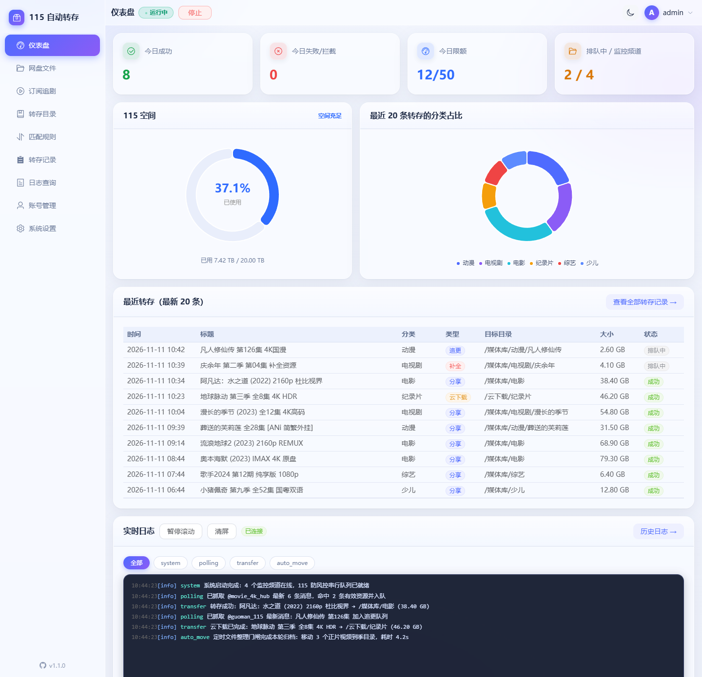

> ⚠️ **当前版本（v1.3.0），功能已较完整但可能仍存在各种各样的问题，使用前请仔细阅读下方风险提示。**

# 115 自动转存助手

监控 Telegram 频道中的 115 分享链接和电驴/磁力下载链接，自动分类转存到 115 网盘对应目录。网页操作全部功能，Docker 一键部署，支持手机访问。

## 界面预览

> 以下为「仪表盘」示例视图（采用测试数据生成，涵盖今日运行概览、115 空间环形预警、分类占比、最近转存流与 WebSocket 实时日志）：



## v1.3.0 修复与加固（同版本重新打包，2026-11-14）

对全项目做了一轮功能逻辑与安全审查，本节列出已部署 v1.3.0 的用户值得了解的修复。**版本号不变、数据库结构无变更**，按「无损升级」步骤覆盖重启即可。

**稳定性修复**：

- 修复网络异常分类失效（缺失 `httpx` 导入）：此前网络抖动会让健康检查整轮跳过，现正确「只告警不熔断」，不再有误判 Cookie 失效导致自动停机的风险
- 修复 TG 内联按钮（「查看资源」→ telegra.ph 中间页）解析失败被永久缓存的问题：telegra.ph 短暂故障期间扫过的按钮链接不会再静默丢失，改为按轮询节奏自动重试
- 修复订阅追更进度回退：频道重发旧集（合集帖/全剧终帖常见）不再把追更进度拉回旧集、不再重复推送通知，进度写入带并发安全守卫
- 整理门闸排空口径修复：活跃频道持续来新消息时，排空等待不会被水线之后的新任务无限饿死；排空期新任务留队待整理结束后继续，不再虚耗每日额度
- 修复整理/刮削结束恢复门闸时的竞态窗口；转存反查未命中改为自动重试确认，**移除跨目录全盘找回**（115 搜索为分词模糊匹配，原实现可能把其他目录同名文件误复制进媒体库）
- 提取器增强：提取码支持 4~8 位（此前 5 位以上会被截断导致转存必败）；识别无提取码的 `115://` 秒传链接；磁力链支持 `xt` 参数前置写法

**安全加固**：

- 「退出登录」接口增加登录态校验，防止未认证请求反复吊销全端会话
- 备份恢复增加设置键白名单校验，`notify_chat_id` 等推送目的地与凭据同口径保护（恢复外来备份时保留本机当前值）
- 日志统一出口脱敏（115 Cookie 字段 / api_hash / Bearer Token），任何异常串携带的凭据都不会进日志库与实时日志流
- 扫码登录客户端标识（app）白名单校验；风控退避词改为词边界匹配，分享码/普通错误串不再误触发 8 倍降速
- 前端：二维码改用 `` 承载（不再以 `v-html` 直插外部接口返回的 SVG）；消息高亮的转义补齐引号

**行为对齐**：

- Userbot 与网页轮询行为统一：系统停止时待机不采集入库，恢复运行后自动补漏停机期间的漏网消息
- 黑名单频道条目支持 `@xxx` 写法（此前带 `@` 的条目永远匹配不到，静默失效）

## 功能

- **双通道转存**：115 分享链接转存 + 云下载（电驴/磁力），可分别开关、分别指定目标目录
- **自动分类**：优先采用频道消息里的标签（#电影 / #剧集 / #动漫 / #综艺 / #纪录片 / #少儿），无标签时按内置或自定义正则匹配；规则可视化编辑 + 实时测试器 + 分类占比饼图
- **精准去重**：消息 ID 与分享码双重去重，同一分享跨频道只转一次；被跳过的重复链接单独记录为「重复」并标注来源，已成功的分享绝不重复转存
- **分享追更**：同一分享链接持续更新（如连载剧补充新集）时自动识别新增文件，只转存新文件，已存过的自动跳过
- **向前补全**：周播剧从中间集数开始追（如首看即 E03）时，可在网页「转存记录」或 Bot 发起向前补全，自动翻找频道历史补齐早期分集；补全任务优先消耗每日额度，早期链接已失效的会失败并注明原因
- **追更订阅库**：支持 TMDB 影视数据库实时检索联动与官方海报展示，匹配年份与评分；对连载中影视自动标记监控追更，有新资源自动排队转存
- **定时文件整理（自动归档与分流）**：
  - **只移动正片**：系统按规则排队扫描源目录，**只移动正片中文视频文件，文件夹本身绝不移动**；支持源目录最多 **2 层子文件夹受控穿透**（兼容 `剧名/Season` 目录），内置目录剪枝、`BDMV`/`VIDEO_TS` 蓝光原盘跳过、扫描配额上限与多规则缓存复用，降低 115 接口请求频次
  - **智能识别、按季入库与按季集防重**：支持「总库智能分流」（自动匹配总库内剧名子目录）与「精确匹配」；自动识别季数归入对应 `Season 1` / `第一季` 文件夹；内置繁简体汉字智能互通匹配与「**按季集防重**」独立开关（默认开启，同剧目标已存在同季同集视频时自动跳过不同命名版本，同批多版本优先保留非副本大体积版本）
  - **独占门闸安全保障（Transfer Gate）**：整理前三阶段门禁（暂停接收新任务 → 排空并等待现有转存/云下载全部完成终态 → 独占挂起转存工作器安全移动 → 结束后全自动恢复），杜绝 115 目录写冲突与并发风控
  - **灵活调度**：支持固定间隔轮询（每 2~24 小时）与每天固定时间点，未来 48 小时时间预测；同时受「防风控定时计划」管辖，静默时段外自动顺延
- **整理刮削（影视目录规范化 + TMDB 刮削与资产管理）**：
  - **目录规范化整理与精确互斥过滤**：支持网盘电影/剧集/动漫目录的合规重命名整理、建立季目录归档与单条/同批一键撤销（`undo`）；添加整理规则时源目录与目标目录强制必选；引入**规则类型精准互斥过滤**，智能判定或显式指定「剧集/电影」类型，严格杜绝同源多规则时的混淆移动与跨库错位
  - **TMDB 智能匹配与零 115 上传**：高置信度影视自动识别，并将生成的 `.nfo` 元数据与海报/背景图持久化保存在**本地宿主机数据目录**（完全规避 115 文件上传风控与封禁）；低置信度/多候选自动挂起进入「待确认」列表，支持网页端点选确认及 Telegram 交互卡片同步确认
  - **定时整理与定时刮削严格串行排队**：支持分别开启「定时整理」与「定时刮削」，支持固定间隔轮询（每 2~48 小时）与每天固定时间点，可直观查看未来 48 小时预测触发时间；**底层执行严格互斥排队（FIFO）**：触发时先执行目录整理，在途转存与云下载先行排空保护，待整理完全结束后再顺次执行媒体刮削，绝不并发，从根本上消灭多模块并发导致的网盘风控
  - **全站删除与高危操作防误触**：整理规则删除、刮削规则删除、操作账本单条/整批撤销、忽略候选条目以及清空完结任务全量配备二次确认弹窗（`el-popconfirm`），保障网盘数据安全
- **115 严格防风控与读写隔离调度**：
  - **串行排队与专用线程池**：后台转存、云下载提交/核对、自动文件整理及网盘写入统一经进程级串行门闸（`pan_call`）排队执行，命中风控词自动逐级放大冷却间隔，并在独立专用线程池中运行，避免阻塞或挤占事件循环与本地任务
  - **轻量读取与频道采集放行**：网盘目录只读浏览/搜索、带单飞合并锁与缓存的 Cookie 检测 / 115 空间查询、扫码登录以及 TG 频道抓取入库均直接放行，确保在后台批量转存或整理期间前台操作与频道抓取依然流畅响应
  - **定时计划**：开启后仅在允许时段内执行转存、云下载与自动文件整理（支持跨零点，如 22:00 ~ 08:00），时段外任务排队保留、自动等待
  - **开工随机扰动**：到达定时时段后随机延迟 0~30 分钟再开工，消除整点脚本特征
  - **拟人化连存小憩**：连续完成多笔转存后自动插入随机小憩（如每存 3 笔随机休息 2~5 分钟），模拟真人离开电脑或浏览，打破固定匀速特征
  - **安全限额与过滤**：单账号每日转存上限（1~50 笔）、分享体积下限过滤（低于设定阈值视为广告自动跳过）
- **对外开放 API（Open API）**：可在「系统设置 → 对外 API」独立生成 `API Token`（请求头 `X-API-Token`，与网页登录完全隔离，带限流保护），支持第三方脚本或 Home Assistant 查询状态（`/api/ext/v1/status`）、读取最近记录（`/api/ext/v1/transfers/recent`）及推送链接入队（`/api/ext/v1/transfers`）
- **数据备份与 Telegram 一键恢复**：
  - **定时自动推送**：可设定间隔天数与具体时间点（如每 7 天 04:00），系统自动将完整数据打包推送到绑定的 Telegram Bot
  - **超大备份自动压缩**：体积超过 8MB 时自动启用 Gzip 最高级别（level 9）压缩，规避 Telegram 文件下载限制
  - **极简恢复**：直接将备份的 `.json` 或 `.json.gz` 文件转发给 Bot 回复 `/restore confirm`，或在网页端导入，即可一键整体覆盖恢复（恢复后以当时生成状态为准自动接续任务；登录密码与 Bot Token 等密钥受保护保留）
- **监控频道管理**：内置于「账号管理」，添加前自动校验可访问性（网页轮询与 Userbot 分别验证），失败提示具体原因；支持启停、消息预览、重置（清空去重记录与抓取游标）、删除
- **黑名单过滤**：关键词 / 频道 / 文件名三层拦截（预置预告、花絮、枪版、广告等 22 条），命中记录可复核、可放行
- **TG 监听双模式**：公开频道网页轮询（免 TG 账号、零风控）+ Userbot 实时监听（支持私有频道）；两种接入在系统停止时统一待机不采集，停机/断线漏消息按每日限额节奏自动回溯补齐
- **115 扫码登录**：网页展示二维码，手机 App 扫码即登录；Cookie 失效自动巡检告警
- **网盘文件管理**：在线浏览 115 全部目录，支持搜索、新建文件夹、查看详情、重命名、复制/剪切/粘贴、移动、删除（进回收站）
- **可靠性与看门狗**：转存后反查目标目录双重确认，反查未命中时自动重试确认（**不做跨目录全盘找回**，杜绝 115 模糊搜索把其他目录同名文件误复制进媒体库）；失效分享直接失败不空耗额度；任务卡死超时（默认 60 分钟，可在设置页 15~720 分钟调整）看门狗自动重新排队；云下载按文件 hash 跟踪真实结果；失败退避重试
- **TG 通知与命令**：多渠道推送（TG / Bark / PushPlus / ntfy），转存成功/失败附明细；TG Bot 支持远程指令（`/status` `/space` `/ls` `/add` `/backfill` `/sub` `/backup` `/restore` `/pause` `/resume` `/retry` `/help`，发 `/menu` 查看交互按钮菜单）
- **玻璃拟态 UI 与移动端适配**：极光渐变背景 + 分层毛玻璃卡片（主/副标题与组内分隔清晰区分）+ 蓝紫渐变主色，支持深/浅色双主题与统一按钮交互状态；全量配置边界校验闭环；手机端自适应侧栏抽屉，所有表格统一配备不透明右侧固定操作列与流畅横滑体验

## 快速部署

```bash
# 1. 上传项目到服务器并解压（zip 内不带顶层目录，直接解到目标目录）
unzip 115atuosave.zip -d 115atuosave && cd 115atuosave

# 2.（可选）编辑 docker-compose.yml 填入 WEB_PASSWORD 强密码；
#    留空则首次启动自动生成随机密码（见下一步），弱默认值（admin123 等）也会被随机密码替换

# 3. 构建并启动（前端已预构建进包内，构建镜像只需 Python 层，1G 内存服务器可用）
docker compose up -d --build

# 4. 首次部署未设置 WEB_PASSWORD 时，查看随机生成的初始密码（二选一）：
docker compose logs autosave115 | grep -A1 "初始密码"   # 提示文件路径
cat data/initial_password.txt                            # 直接读取（登录改密后自动删除）
```

> 自行修改前端代码（web/ 目录）后，需在开发机执行 `cd web && npm install && npm run build` 重新生成 backend/static，再构建镜像。

> **海外 VPS 提示**：115 对登录接口有 IP 风控，海外/机房 IP 扫码后可能提示「老乡验证失败 / IP 登录异常」。
> 可在本地电脑浏览器登录 115.com，按页面指引复制 Cookie，用「账号管理 → 手动导入 Cookie」完成登录。

打开 `http://服务器IP:38080`（本机可 `http://127.0.0.1:38080`）访问，账号 `admin`，密码为你设置的 `WEB_PASSWORD`（未设置则为自动生成的随机密码）。

> 面板可直接操控 115 账号，端口默认监听所有网卡（`0.0.0.0:38080`），局域网/公网可直接访问。
> 请务必设置强 `WEB_PASSWORD`；若只想本机访问（通过反向代理或 SSH 隧道），在同目录 `.env`
> 写入 `PAN_BIND_IP=127.0.0.1`。建议公网场景加一层 Caddy 自动 HTTPS 反代；反代场景请同时
> 设置 `TRUSTED_PROXIES=代理IP/网段`，否则登录限速按直连代理 IP 计算：

```
pan.example.com {
    reverse_proxy 127.0.0.1:38080
}
```

## 公网部署安全清单（v1.3.0 起）

面板可直接操控 115 账号，公网暴露前请逐项确认：

- [ ] **强密码**：`WEB_PASSWORD` 设为 12 位以上随机密码（登录有限速：单 IP 5 次/分钟）；
      登录后建议在右上角改掉部署时写入的密码
- [ ] **HTTPS 反代**（强烈建议）：无 HTTPS 时登录密码与登录态 Cookie 走明文传输，
      可能被链路嗅探。套一层 Caddy/Nginx 自动 HTTPS 后，登录态 Cookie 自动带 Secure 标记
- [ ] **反代场景设置 `TRUSTED_PROXIES`**：否则所有请求都被视为来自代理 IP，
      登录限速会变成全局共享桶（攻击者连续失败会短暂影响你的登录）
- [ ] **保持系统更新**：面板不对第三方提供注册，唯一入口是管理员账号
- [ ] 登录态为 HttpOnly Cookie（脚本不可读）；**右上角「退出登录」会吊销全部已签发会话**，
      怀疑泄露时登出一次即可全端下线

## 无损升级（保留全部数据）

升级只替换程序代码，`./data` 数据卷（数据库 / 115 Cookie / TG session / 日志 / 本地元数据）原样保留：

```bash
cd 115atuosave
# 1.（可选但建议）先备份数据卷
cp -r data ../data.bak-$(date +%F)

# 2. 覆盖程序文件（解压新包到当前目录；zip 不含 data/，不会碰到你的数据）
unzip -o 115atuosave.zip -d . -x "data/*"

# 3. 重建镜像并启动（数据库结构与设置完全向后兼容，无手工迁移步骤）
docker compose up -d --build

# 4. 确认升级成功：页脚版本号应为新版本（如 v1.3.0）
```

升级行为说明：

- 旧版登录会话在升级后仍然有效（最多保留至原 7 天有效期）；如需全部重新登录，
  升级后在网页点一次「退出登录」即可
- 旧版密码哈希在下次登录成功时自动升级为更强算法（600k 轮 PBKDF2），无需手工处理
- 浏览器缓存了旧页面时无需强刷：首页 `index.html` 已设为不缓存，资产文件名带内容哈希
- 每次发版的数据库结构变更都在启动时自动迁移（`backend/database.py` 的 `_migrate`），
  且升级兼容性有专项测试保护（`tests/test_upgrade_compat.py`）

## 首次使用

登录后进入初始化向导，按提示完成 4 步：

1. **115 扫码登录** — 手机 115 App 扫网页上的二维码
2. **选择 TG 接入方式** — 推荐「网页轮询」（公开频道即可，不需要 TG 账号）；私有频道再选 Userbot（建议用小号）
3. **添加频道** — 粘贴频道链接（如 `https://t.me/s/regeng115`），每行一个；系统会逐个校验可访问性，失败的频道会提示原因，修正后再继续
4. 完成 → 系统开始自动监控转存

## 日常使用

| 页面 | 用途 |
|---|---|
| 仪表盘 | 今日统计、115 网盘容量预警、分类占比饼图、最近转存流、系统实时日志 |
| 网盘文件 | 浏览 115 全量目录、在线搜索、多选与复制/移动/剪切/粘贴、重命名、删除（回收站）、新建文件夹（只读浏览放行不卡顿） |
| 订阅追剧 | TMDB 影视库实时检索联动、官方海报与评分展示、标记连载订阅、自动增量追更 |
| 转存目录 | 分类→目录映射（分享与云下载支持独立目录）、定时文件整理（自动归档/分流/2 层受控穿透/按季集防重/繁简互通/三阶段门禁） |
| 整理刮削 | 目录规范化整理（源/目标必选/类型精准互斥/撤销复原）、TMDB 刮削与本地 `.nfo`/海报（零 115 上传）、定时整理与刮削严格串行排队调度 |
| 匹配规则 | 正则分类规则与优先级、内置正则测试器、黑名单拦截过滤（关键词/频道/文件名三层过滤与命中放行） |
| 转存记录 | 任务状态筛选、失败批量重试、重复追溯、周播剧向前补全（补齐早期分集）、单条/批量清理 |
| 日志查询 | 历史运行日志按天查阅与打包导出（保留 7 天，自动滚动清理） |
| 账号管理 | 115 扫码/手动导入 Cookie、Userbot 账号登录、Telegram 监控频道统一管理（独立并发加载，支持可访问性检测/启停/仅订阅/重置/删除/消息预览） |
| 系统设置 | 防风控策略（定时计划/随机扰动/连存小憩）、转存限额、自动备份计划、通知渠道扩展、TG 指令与对外 API Token 配置 |

**TG 通知与远程指令**：在「系统设置 → 通知」填入 Bot Token 和 Chat ID，点「发送测试消息」验证。配好后转存与云下载结果会实时排队推送，还可直接给 Bot 发送指令进行远程管理：
- `/menu` — 弹出可视化快捷操作按钮菜单
- `/status` — 查看系统当前运行状态与队列积压
- `/space` — 查询 115 网盘剩余空间
- `/ls` — 查看最近 5 条转存记录
- `/add <频道> on|off` — 添加监控频道（`on`=仅订阅、`off`=全盘转存）
- `/sub [片名]` — 查看订阅或检索 TMDB 点选添加追更（`/sub del <关键词>` 删除）
- `/backfill [剧名]` — 向前补全早期分集
- `/backup` — 立即导出并发送当前完整数据备份文件（`.json` 或 `.json.gz`）
- `/restore` — 发送备份文件给 Bot 后，回复 `/restore confirm` 快速一键恢复
- `/pause` / `/resume` — 暂停或恢复转存工作器
- `/retry` — 一键重试全部失败任务

**关于频道记录与重置**：每个监控频道会记录已处理的消息 ID 与抓取游标。点击「重置」会清空该频道的处理标记，从频道最新消息重新开始；点击「删除」会彻底清除该频道的本地记录，再次添加时将按全新频道重新处理。

## 数据与维护

- **数据持久化**：所有核心数据（SQLite 数据库、115 Cookie、TG session、运行日志）均保存在 `data/` 目录中。
- **备份机制（双重保障 + 整机迁移包）**：
  - **定时自动备份**：在「系统设置」开启定时备份并指定推送时间与间隔天数，系统会自动将加密安全的业务快照推送给您的 Telegram Bot（超过 8MB 自动启用 Gzip 压缩）；
  - **手动导出**：可在网页「系统设置 → 导出数据备份」随时下载最新的 JSON 备份文件；
  - **网页整机迁移 ZIP 包**：支持在网页端估算体量后导出包含 SQLite 一致性快照（含业务/历史瘦身可选）的迁移 ZIP 包（可选附带登录凭据与本地 `.nfo`/海报资产），并支持流式上传预览与整机恢复；
  - **冷备份迁移**：也可以直接拷贝服务器上的 `data/` 目录进行完整冷备份。
- **极简恢复与数据接续**：
  - **Telegram 恢复**：把收到的 `.json` 或 `.json.gz` 备份文件直接转发给 Bot，Bot 会回显数据摘要并提示回复 `/restore confirm`，确认后即可完成整体覆盖恢复；
  - **网页端恢复**：在「系统设置 → 从备份恢复」选择备份文件上传即可；
  - **自动接续运行**：恢复后系统默认停在安全停止状态，用户确认数据无误后点击顶栏「运行」，系统会以备份时的状态为准，**自动接续未完成的排队任务，并自动追赶补齐备份时间点之后频道里发布的新增消息**；
  - **凭据隔离保护**：备份文件严格排除当前登录密码、Bot Token 与代理配置，恢复时保留当前有效凭据不变，防止恢复后被锁在门外。
- **无损升级**：替换最新项目文件后执行 `docker compose up -d --build`，原有数据与设置保持无损。

## 风险提示

- 115 转存使用 Cookie + 官方自用接口（非开放平台 API），程序已内置随机间隔/每日限额/失败退避缓解风控，建议先用不重要的账号试跑几天
- Userbot 模式使用真实 TG 账号，有封号风险，务必用小号
- 仅供个人学习研究使用

## 技术栈

FastAPI + SQLite + Telethon + [p115client](https://github.com/ChenyangGao/web-mount-packs) ｜ Vue 3 + Element Plus + ECharts ｜ Docker

## 本地开发

```bash
# 后端
python -m venv .venv
.venv/Scripts/pip install -r backend/requirements.txt   # Windows
.venv/bin/pip install -r backend/requirements.txt       # Linux/Mac
# 可复现安装（依赖版本锁定）：pip install -r backend/requirements.lock
# 需要跑测试的完整开发环境（含 pytest 等）：pip install -r backend/requirements.lock.txt
.venv/Scripts/python -m uvicorn backend.main:app --port 8000 --reload

# 前端（另开终端，/api 自动代理到 8000）
cd web && npm install && npm run dev    # http://localhost:5173

# 测试（模拟集成测试 + 单元测试）
.venv/Scripts/python tests/test_worker_mock.py
.venv/Scripts/python -m pytest tests --ignore=tests/test_api_integration.py --ignore=tests/test_worker_mock.py -q
```
