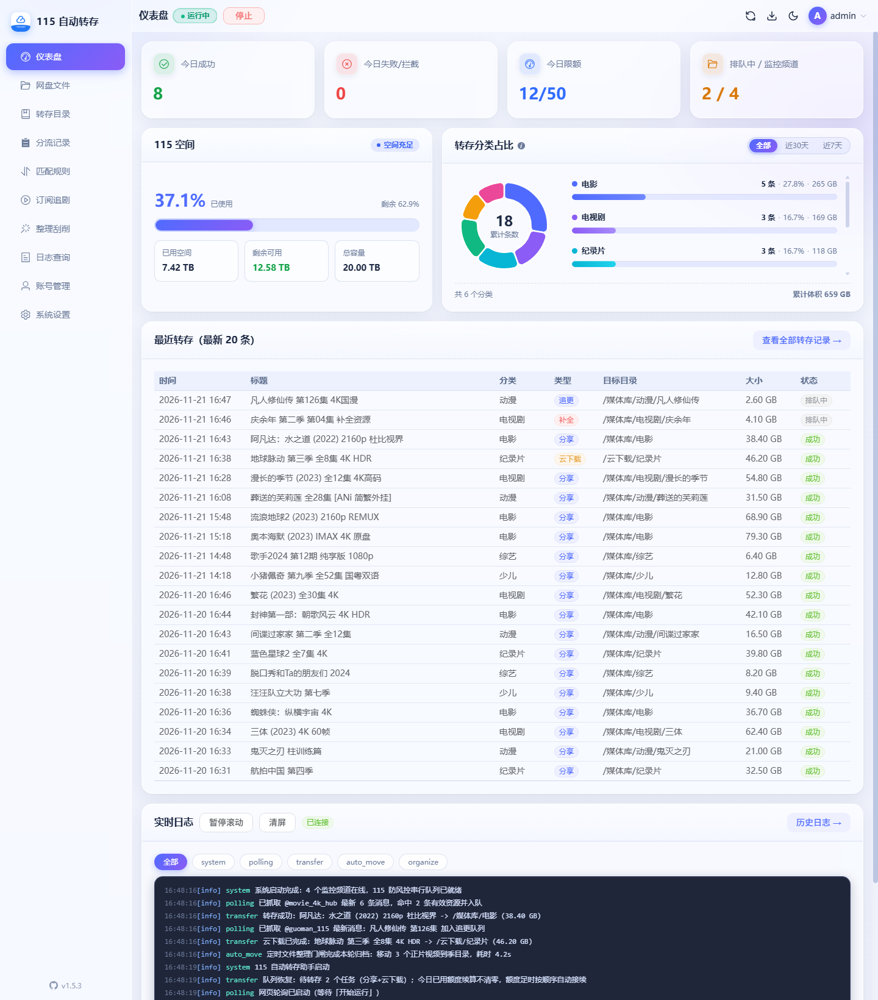

> ⚠️ **当前版本：`v1.6.0`**，使用前请先阅读文末风险提示。

# 115 自动转存助手

监控 Telegram 频道中的 115 分享链接与磁力/电驴链接，自动分类转存、追更洗版、目录归档与 TMDB 本地刮削。全网页管理，Docker 一键部署，支持 PWA 与手机端使用。



## v1.6.0 更新内容

- **洗版与防风控联动**：
  - 「整理刮削 → 策略与设置」重名冲突策略升级为「高画质替换（旧版移至归档目录）」，新增「BDMV 蓝光原盘优先」开关，并与「系统设置 → 洗版升级」共用同一旧版归档目录；替换后自动清理过期本地元数据；
  - 「定时维护」更名为「风控管理」，整理刮削与转存/归档共用防风控允许时段、开工扰动与连存小憩，时段外触发自动顺延。
- **订阅追剧升级**：
  - TMDB 选剧拆分为独立面板，提供 7 个精选榜单、类型/地区/排序筛选、隐藏已订阅与 IMDb ID（`tt...`）检索；
  - 支持负向排除词、电影命中自动停用、弹窗编辑与分页展示，并直连质量策略状态。
- **匹配规则、黑名单与转存整理**：
  - 规则表支持备注、筛选、常用模板与上下调序；黑名单支持检索、分页与「放行并移除该词」；
  - 定时自动归档分流支持按规则开启「匹配英文片名」及统一弹窗预览；转存记录支持快捷状态统计胶囊与无效记录一键清理；网盘文件浏览接入独立节流与 15 秒目录缓存。
- **体验与部署优化**：
  - 仪表盘「转存分类占比」升级为全宽多列卡片展示，「115 空间」并排紧凑展示；
  - 全局主题细节打磨（细滚动条、顶栏轻毛玻璃、激活页签刷新保持、非登录表单禁用浏览器自动填充、顶栏/下拉刷新图标重绘）；
  - 系统设置补全 Webhook 测试与格式校验、快速搜索索引；Docker 镜像多阶段深度瘦身，体积更小。

## v1.5.6 更新内容

- **全站 UI 重构（Linear Studio System）**：升级深色模式配色与卡片/控件圆角边框规范，统一表单提示条（Tip Box）样式，并优化桌面端与移动端（iOS Safari / Android / PWA）的响应式布局与触控体验。
- **状态刷新与连接反馈体验优化**：
  - 账号管理页「刷新状态」支持真实即时刷新与冷却防连击保护（带 5 秒冷却倒计时与即时加载动画反馈）；
  - TG Userbot、WebDAV、通知渠道测试弹窗与状态反馈体验统一，操作进度更清晰。
- **备份与弹窗居中体验优化**：
  - 修正 WebDAV 历史备份与运行状态记录时间戳异常问题；
  - 优化弹窗垂直流式居中，修复长页面或滚动后弹窗出现在视口外需要上滑的问题。
- **后端模块化与健壮性**：
  - 115 分享遍历与转存接收解耦抽离为独立子模块（`backend/pan115/share.py`）；
  - 全库源码继续 100% 遵守 800 行红线规范。

## v1.5.5 更新内容

- **线程池隔离与防阻塞**：门禁空间探测、TMDB 刮削、WebDAV 备份、通知推送及同步 SQLite 查询改用专用线程池，容量查询新增等锁超时与旧缓存降级，消除门禁轮询超时告警与高负载卡顿；115 写操作仍全程串行排队，防风控逻辑不变。
- **前端文案规范化**：
  - 全站错误提示中文化，不再把 `Network Error`、`timeout of 30000ms exceeded` 等底层英文直接抛给用户；
  - 统一术语：转存 / 云下载 / 查重 / 洗版升级 / 目录整理 / 媒体刮削 / 115 网盘网页端；
  - 修正指向不存在按钮的提示；删除、中断、批量删除等危险操作补全作用范围与可撤销说明；
  - 整理动作、黑名单规则类型、通知渠道等不再显示英文枚举值。
- **回归测试**：新增空间查询等锁超时与线程池隔离用例；后端回归 182 项、Worker 状态机 263 项全部通过。

## v1.5.4 更新内容

- **云端备份安全加固**：WebDAV 备份服务地址、账号与应用密码不再随 JSON 快照/迁移包导出；恢复外来备份也不会把定时备份改推到未知服务器，备份连通性与最近备份状态按本机独立维护。
- **恢复接口安全校验**：WebDAV 预览恢复、执行恢复与删除备份统一校验 `autosave_*.zip` 文件名，阻断 `..`、斜杠等路径穿越写法；底层下载客户端同步加入文件名校验。
- **升级兼容修复**：旧版本升级时若此前已开启定时自动备份，自动回填 TG Bot 通道，避免因新增的多通道配置为空导致备份循环静默跳过。
- **统计修正**：手动导出到 WebDAV 后的“最近备份时间”改用系统时间，修复此前显示为 1970 年的问题。

## v1.5.3 更新内容

- **单体架构全面拆解（0 豁免）**：完成 10 个历史大文件（5 前端 + 5 后端）的模块化拆分并清空豁免基线，全库源码文件全部遵守 800 行上限红线。
- **自动化测试防护网加固**：接入 `pytest-cov` 65% 覆盖率基线与 FastAPI `TestClient` 内存集成测试，163 项回归测试与 263 项 Worker 状态机测试全量通过。

<details>
<summary>历史版本更新（v1.5.2 / v1.5.1 / v1.5.0 / v1.4.0）</summary>

- **v1.5.2**：
  - **工程治理与模块化红线**：全面解耦 6 大核心模块；引入 800 行防膨胀红线与 CI 校验。
  - **仪表盘全景升级**：紧凑 Aurora Glass 布局，全历史分类统计与加粗进度条设计。
  - **全站交互与安全防误触**：统一居中 Aurora Glass 确认框、前置 `InfoFilled` 悬浮气泡、分页抽屉。
  - **转存与清理体验优化**：修复手动转存分类下拉为直选网盘目录，优化重复清理步进器。

- **v1.5.1**：
  - **网盘文件增强**：按需统计目录大小与文件数（5 分钟缓存 + 节流）；服务端排序（名称/修改时间/创建时间）与类型筛选；全盘/当前目录搜索切换；弹窗直选目标移动、常用目录书签、搜索结果进入所在目录、多选体积汇总、文件类型图标区分与回收站查看/还原；详情页上级目录同步显示名称与 ID。
  - **危险操作统一醒目红**：全站删除菜单项、删除/清理/重复文件移入回收站及备份覆盖恢复等二次确认弹窗统一改为红色（适配深/浅主题）。
  - **细节与文档**：精简 README，优化移动端面包屑折叠与详情排版。
- **v1.5.0**：PWA 桌面/移动端安装与 Web Share Target 系统分享转存；三套预览（分流/整理刮削/重复清理）全面异步化；SQLite 扫描索引增量复用与防风控扫描预算；扫描范围护栏与全屏防误操作遮罩。
- **v1.4.0**：云下载按任务目录名归档与整理账本撤销；整理刮削预览确认与本地元数据零上传；画质策略与洗版归档；115 空间门闸（≥90% 自动暂停）与 ≥1TB 超大资源提示；TG Bot 直发指令头与一键系统自检。

</details>

## 核心功能

- **TG 监听与双通道转存**：支持公开频道网页轮询（免 TG 账号）与 Userbot 实时监听（支持私密频道），断线自动回溯补漏；115 分享转存与云下载（磁力/电驴）可独立开关并分设目录。
- **智能分类与去重过滤**：优先识别频道标签（`#电影`/`#剧集`/`#动漫` 等及别名），无标签走可编辑正则规则与未分类兜底；消息 ID + 分享码双重去重，支持连载分享增量更新与三层黑名单（频道/关键词/文件名）+ 体积下限拦截。
- **订阅追更与质量洗版**：联动 TMDB 检索海报与评分，按订阅自动追剧、周播剧向前补全；按分辨率/来源/编码择优，低于门槛跳过，开启洗版后高画质自动覆盖并把旧版移入归档目录（只移不删）。
- **自动整理与刮削**：
  - **定时自动归档分流**：按规则移动含中文片名的正片视频（不移文件夹、跳过原盘），支持 2 层穿透、云下载按任务目录归档、按季入库及繁简/季集查重，移动记录支持单条或整批撤销。
  - **目录整理与媒体刮削**：两段式预览确认整理；高置信度自动匹配，`.nfo` 与海报仅保存宿主机本地（零 115 上传风控）；低置信度进入网页/TG 待确认队列。
  - **重复清理**：按 SHA1 扫描同内容重复文件，预览确认后移入 115 回收站。
- **网盘文件管理**：在线浏览、全盘/当前目录搜索、服务端排序与类型筛选、按需统计目录大小、弹窗选目录移动、复制/剪切/重命名/删除、常用目录书签与回收站一键还原；只读浏览不阻塞后台写任务。
- **防风控与可靠性**：转存、整理与刮削等后台写操作统一串行排队执行，命中风控自动逐级退避；支持允许时段（可跨零点）、开工随机扰动、连存小憩、每日上限、空间门闸与卡死任务看门狗回收。
- **通知、Bot 与对外 API**：支持 TG / Bark / PushPlus / ntfy 推送与 TG Bot 远程指令；提供独立 `X-API-Token` 开放接口（`/api/ext/v1/*`）供第三方脚本或 Home Assistant 接入。

## 快速部署

```bash
# 1. 解压发行包（无顶层目录）
unzip 115autosave.zip -d 115autosave && cd 115autosave

# 2. 启动服务（内置预构建前端，1G 内存可用）
docker compose up -d --build

# 3. 首次未在 .env / compose 设置强 WEB_PASSWORD 时，读取自动生成的初始密码
cat data/initial_password.txt   # 登录后在右上角修改密码，文件会自动删除
```

访问 `http://服务器IP:38080`，默认账号 `admin`。修改前端源码后需先在 `web/` 重新构建再重建镜像（见文末开发命令）。

> **公网安全建议**：
> - 仅本机/反代访问请在同目录 `.env` 写入 `PAN_BIND_IP=127.0.0.1`；
> - 公网务必套 Caddy/Nginx 自动 HTTPS，并在 `.env` 配置 `TRUSTED_PROXIES=代理IP/网段` 以保证登录限速（单 IP 5 次/分钟）准确；
> - 登录态为 HttpOnly Cookie，右上角「退出登录」会吊销全部已签发会话；
> - 海外 VPS 扫码若遇 115 IP 风控，可在「账号管理」手动导入本机浏览器 Cookie。

## 无损升级

`./data` 保存全部业务数据与凭据，发行包不含 `data/`，升级时自动平滑迁移数据库结构：

```bash
cd 115autosave
cp -r data ../data.bak-$(date +%F)          # 建议先备份数据卷
unzip -o 115autosave.zip -d . -x "data/*"   # 如手动改过 docker-compose.yml 请一并排除
docker compose up -d --build
```

## 移动端支持（PWA & Android）

- **推荐 PWA**：iOS Safari「分享 → 添加到主屏幕」或 Android Chrome/Edge「安装应用」即可独立窗口运行，Android 端支持系统「分享 → 115转存」一键入队。
- **可选 Android APK**：`android/` 为 WebView 壳工程，推送 `v*` 标签由 GitHub Actions 自动构建并挂到 Release。

## 页面与 TG Bot 速查

| 页面 | 主要用途 |
|---|---|
| 仪表盘 | 今日概览、115 容量预警、分类占比、最近转存流、实时日志 |
| 网盘文件 | 浏览/搜索/排序筛选、按需算目录大小、移动/复制/重命名/删除、书签与回收站还原 |
| 转存整理 | 分类→目录映射（分享与云下载独立）、定时自动归档分流规则与预览执行 |
| 记录查询 | 转存任务管理（重试/向前补全/批量删）与整理记录账本（单条/整批撤销） |
| 匹配规则 | 分类正则与测试器、三层黑名单管理与拦截放行 |
| 订阅追剧 | TMDB 搜片订阅、追更进度与画质门槛 |
| 整理刮削 | 目录整理、媒体刮削、重复清理与定时串行调度 |
| 系统日志 | 历史日志查询与导出 |
| 账号管理 | 115 登录、Userbot 与频道管理 |
| 系统设置 | 转存控制、消息通知、风控管理、洗版升级、备份恢复、开放接口与系统自检 |

**TG Bot 常用指令**：`/menu`（快捷菜单）、`/status`、`/ls`、`/add <频道> on|off`、`/sub [片名]`、`/backfill [剧名]`、`/archive [run]`、`/retry`、`/backup`、`/restore confirm`、`/start`、`/stop`。  
**直发转存格式**：`转存 [分类] <115分享链接>` 或 `云下载 [分类] <磁力/电驴链接>`（分类可省略）。

## 数据备份与迁移

- **自动/手动快照**：支持定时推送加密安全快照至 TG（超 8MB 自动 Gzip），也可网页导出/导入或转发给 Bot 回复 `/restore confirm` 恢复；快照默认剔除登录密码与通知密钥等敏感凭据。
- **整机迁移 ZIP 包**：网页端支持估算体积后流式导出/恢复完整数据库快照、可选凭据与本地 `.nfo`/海报资产；冷备份可直接复制 `data/` 目录。

## 风险提示

- 115 转存基于 Cookie 与官方自用接口，虽已内置串行门闸、风控退避与每日限额，仍建议先用测试账号试跑。
- Userbot 监听使用真实 TG 账号，存在封号风险，务必使用小号；公开频道优先使用网页轮询。
- 本项目仅供个人学习研究使用。

## 技术栈与本地开发

FastAPI + SQLite + Telethon + [p115client](https://github.com/ChenyangGao/web-mount-packs) ｜ Vue 3 + Element Plus + ECharts ｜ Docker

```bash
# 后端
python -m venv .venv
.venv/Scripts/pip install -r backend/requirements.lock.txt   # 完整开发与测试依赖（生产镜像使用 backend/requirements.lock）
.venv/Scripts/python -m uvicorn backend.main:app --port 8000 --reload

# 前端
cd web && npm install && npm run dev     # 开发预览（/api 代理到 8000）
cd web && npm run lint && npm run build  # 轻量静态检查 + 预构建到 backend/static

# 测试与检查
.venv/Scripts/ruff check backend tests
.venv/Scripts/python tests/test_worker_mock.py
.venv/Scripts/python -m pytest tests --ignore=tests/test_worker_mock.py -q
```
